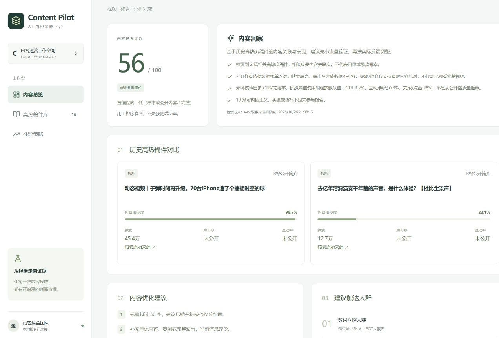
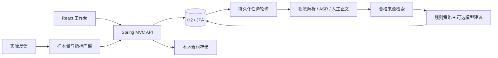

# Content Pilot

面向内容运营的 AI 辅助分析平台：上传图文、音频或视频，检索历史参照，生成分阶段试投建议，再通过实际反馈决定是否扩量。

**Java 25 · Spring Boot 4.1 · Spring AI 2.0 · React 18 · TypeScript · H2**



## 功能

- 内容工作台：素材上传、正文编辑、异步分析、失败重试、报告导出与历史归档。
- 多模态接入：图片通过视觉模型解析；音频通过 ASR 转写；视频通过 FFmpeg 提取音轨后转写。
- 历史检索：支持 Spring AI 向量模型；未配置模型时使用中文双字片段相似度，报告标明实际分析模式。
- 来源追溯：展示原文链接、采集时间、公开指标与覆盖范围；缺正文的来源不参与语义检索。
- 反馈闭环：根据实际曝光、点击、互动与完成数据，给出观察、扩量或暂停扩量建议。

## 快速开始

需要 JDK 25、Node.js 22 和 npm。默认无需模型密钥或外部数据库，前后端打包为一个服务。

```bash
git clone https://github.com/niha717/content-pilot.git
cd content-pilot
```

Windows PowerShell（JAVA_HOME 指向本机 JDK 25）：

```powershell
.\scripts\build.ps1
.\scripts\start.ps1
```

Linux / macOS：

```bash
npm ci --prefix frontend
npm run build --prefix frontend
chmod +x gradlew
./gradlew test bootJar
java -jar build/libs/content-pilot-0.1.0.jar
```

打开 [本地平台](http://127.0.0.1:8080)，健康检查为 /api/health。数据和附件保存在 data/。Windows 构建脚本使用临时英文目录，避免中文路径导致 Gradle 测试类加载失败。

体验流程：新建内容 → 填写正文或上传素材 → 发起分析 → 查看参照与预算 → 回填数据 → 查看扩量判断。未配置模型时，音视频可手动填写转写文本。

### 模型配置与开发

复制 .env.example 为 .env，填写服务端密钥和兼容端点，将需要启用的 AI_CHAT_PROVIDER / AI_EMBEDDING_PROVIDER 设为 openai。PowerShell 启动脚本读取 .env；其他启动方式需要自行导出环境变量。音视频转写另需 ASR_API_KEY，视频处理另需 FFmpeg。

配置的模型服务会接收分析所需的正文、素材与历史简介。密钥仅保存在服务端，不能提交到版本库。素材上传上限为 100 MB，转写文件上限为 24 MB。

前端独立开发：在 frontend 目录运行 npm ci 和 npm run dev，访问 5173 端口，API 代理到本地 8080 服务。

## 设计



模型辅助理解与表达，扩量门槛由确定性规则计算。曝光不足 1,000 次时保持观察；达标后，CTR、互动/曝光、完成/点击三项均达标才建议扩量。缺少可信内部样本时使用默认试投阈值 3.2%、0.8%、28%，尚未经业务校准。

详细说明：[架构与接口](docs/architecture.md) · [数据来源](docs/data-provenance.md) · [开发约定](CONTRIBUTING.md)

## 验证与边界

```bash
npm run format:check --prefix frontend
npm run build --prefix frontend
./gradlew test bootJar
```

## 许可与参考

原创应用代码使用 [MIT License](LICENSE)。上传、异步处理、检索与报告的设计参考 [InterviewGuide](https://github.com/Snailclimb/interview-guide)，业务实现独立编写。第三方工具与公开内容权利归原权利人，见 [NOTICE](NOTICE)。
